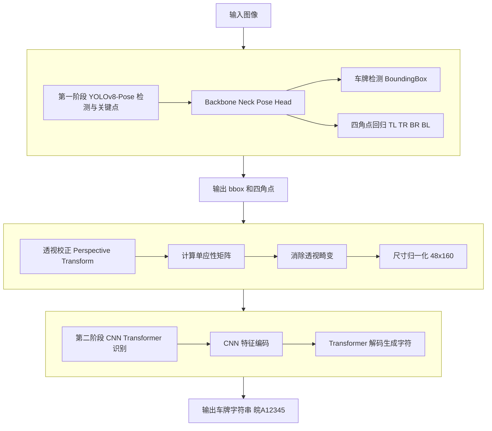

## 一、整体架构：两阶段检测识别流程



---

## 二、为什么需要两阶段设计？

### 1. **分离关注点**
- **检测阶段**：解决"在哪里"的问题——车牌在图像的什么位置，姿态如何
- **识别阶段**：解决"是什么"的问题——校正后的车牌上有哪些字符

### 2. **透视校正的关键作用**
直接从自然场景图像识别字符存在以下问题：
- 透视畸变（近大远小）
- 旋转倾斜
- 光照不均

通过4个角点进行透视变换，可以得到：
- **正面视角**的标准车牌图像
- **统一尺寸** (48×160)，便于模型处理
- **消除几何畸变**，提高识别准确率

---

## 三、CNN-Transformer 识别器深度解析

### 3.1 整体架构设计思想

这个模型采用了 **Encoder-Decoder** 架构，但与传统机器翻译不同：

| 传统机器翻译 | 本LPR系统 |
|-------------|----------|
| Transformer Encoder + Decoder | **CNN Encoder** + Transformer Decoder |
| 输入：文本序列 | 输入：图像 (48×160×3) |
| Encoder处理源语言 | CNN提取视觉特征 |
| Decoder生成目标语言 | Decoder生成字符序列 |

**为什么用CNN而不是Transformer做编码器？**
- CNN更适合处理局部视觉特征（边缘、纹理、笔画）
- 参数效率更高（相比ViT等Vision Transformer）
- 对于固定尺寸、结构化内容（车牌）效果优异

---

### 3.2 CNN视觉编码器详解

#### 网络结构 (model.py: 65-73)

```python
self.cnn_encoder = nn.Sequential(
    # Layer 1: 3→64通道，下采样2×
    Conv2d(3, 64, k=3, s=1, p=1) → BN → ReLU → MaxPool(s=2)
    # 输出: [B, 64, 24, 80]

    # Layer 2: 64→128通道，下采样2×
    BasicBlock(64, 128, stride=2)  # 残差块
    # 输出: [B, 128, 12, 40]

    # Layer 3: 128→256通道，下采样2×
    BasicBlock(128, 256, stride=2)
    # 输出: [B, 256, 6, 20]

    # Layer 4: 256→512通道，下采样2×
    BasicBlock(256, 512, stride=2)
    # 输出: [B, 512, 3, 10]
)
```

#### 特征图尺寸变换过程

```
输入: [B, 3, 48, 160]  (原始车牌图像)
  ↓ Conv+Pool (stride=2)
    [B, 64, 24, 80]    # 尺寸缩小2×
  ↓ BasicBlock (stride=2)
    [B, 128, 12, 40]   # 尺寸缩小4×
  ↓ BasicBlock (stride=2)
    [B, 256, 6, 20]    # 尺寸缩小8×
  ↓ BasicBlock (stride=2)
    [B, 512, 3, 10]    # 尺寸缩小16×
  ↓ Flatten to sequence
    [30, B, 512]       # 3×10 = 30个特征向量
```

#### 残差块 (BasicBlock)

```python
class BasicBlock(nn.Module):
    # 残差连接: out = F(x) + x
    # 作用:
    # 1. 缓解梯度消失
    # 2. 允许更深网络
    # 3. 保留低层特征
```

#### 从特征图到序列 (model.py: 107)

```python
# CNN输出: [B, 512, 3, 10]
# 展平为序列: [B, 512, 30] → [30, B, 512]
memory = cnn_features.view(B, C, -1).permute(2, 0, 1)
#         ↑                 ↑
#      展平H×W           转换为 [seq_len, batch, dim]
```

**序列长度30的物理意义**：
- 每个位置对应原始图像的一个**感受野区域**
- 大约覆盖 16×16 像素的原始区域
- 相当于将车牌划分为30个"视觉词元"

---

### 3.3 Transformer解码器详解

#### 位置编码 (PositionalEncoding)

```python
# 正弦位置编码 (Vaswani et al., 2017)
PE(pos, 2i)   = sin(pos / 10000^(2i/d_model))
PE(pos, 2i+1) = cos(pos / 10000^(2i/d_model))
```

**作用**：为序列中的每个位置添加位置信息，因为自注意力机制本身是位置无关的。

#### 训练时的前向传播 (forward方法)

```
输入:
  src_img: [B, 3, 48, 160]           # 车牌图像
  tgt_tokens: [B, 10]                # [<s>, 皖, A, 1, 2, 3, 4, 5, </s>, <pad>]

步骤1: CNN编码
  memory = CNN_Encoder(src_img)       # [30, B, 512]
  # memory是视觉特征的"记忆"，包含所有视觉信息

步骤2: 准备解码器输入
  tgt_emb = Embedding(tgt_tokens)    # [10, B, 512]
  tgt_pos = tgt_emb + PositionalEncoding  # 添加位置信息

步骤3: 生成因果掩码
  tgt_mask = causal_mask(10)
  # 防止看到未来信息（训练时teacher forcing）
  # 形状:
  # [  0,  -∞,  -∞, ...,  -∞]
  # [  0,   0,  -∞, ...,  -∞]
  # [  0,   0,   0, ...,  -∞]
  # ...

步骤4: Transformer解码
  decoder_output = TransformerDecoder(
      tgt=tgt_pos,      # 目标序列（已生成部分）
      memory=memory,    # 视觉记忆（来自CNN）
      tgt_mask=tgt_mask # 因果掩码
  )  # 输出: [10, B, 512]

步骤5: 输出预测
  logits = FC(decoder_output)         # [10, B, vocab_size=68]
  # vocab_size = 31省份 + 24字母 + 10数字 + 3特殊token = 68
```

#### 自注意力机制

```python
# 对于每个解码位置 t
Q_t = tgt_pos[t] @ W_Q   # Query: "我需要什么信息"
K = memory @ W_K          # Key: "每个视觉位置提供什么"
V = memory @ W_V          # Value: "实际的特征内容"

attention = softmax(Q_t @ K^T / √d_model) @ V
#           ↑
#         计算每个视觉位置的重要度权重
```

**直观理解**：解码器在生成每个字符时，会"关注"图像中的不同区域。

---

### 3.4 推理时的自回归生成 (inference方法)

```python
def inference(self, src_img, start_token_idx, end_token_idx):
    # 步骤1: 提取视觉特征（只计算一次）
    memory = cnn_encoder(src_img)  # [30, B, 512]

    # 步骤2: 初始化目标序列
    tgt_tokens = [<s>]  # 只包含起始符

    # 步骤3: 自回归生成
    for step in range(max_len):
        # 用已有序列预测下一个字符
        output = transformer_decoder(tgt_tokens, memory)
        next_token = argmax(output[-1])  # 取最后一个位置的预测

        tgt_tokens.append(next_token)

        if next_token == </s>:
            break  # 遇到结束符停止

    return tgt_tokens  # [<s>, 皖, A, 1, 2, 3, 4, 5, </s>]
```

**生成过程示例**：

```
Step 0: 输入 [<s>]          → 预测 "皖"
Step 1: 输入 [<s>, 皖]      → 预测 "A"
Step 2: 输入 [<s>, 皖, A]   → 预测 "1"
Step 3: 输入 [<s>, 皖, A, 1] → 预测 "2"
...
Step 7: 输入 [<s>, 皖, A, 1, 2, 3, 4, 5] → 预测 "</s>"
Step 8: 检测到</s>，停止生成
```

---

## 四、关键技术点分析

### 4.1 为什么是30个视觉token？

```python
# 输入: 48×160
# CNN下采样16×: 3×10 = 30个位置

# 这个设计的合理性:
# 1. 30 ≈ 最大车牌字符数(8) × 安全余量
# 2. 每个token的感受野约16×16像素，能覆盖一个字符
# 3. 序列不会太长，计算效率高
```

### 4.2 训练与推理的差异

| 训练模式 | 推理模式 |
|---------|---------|
| Teacher Forcing（使用真实标签） | 自回归（使用模型预测） |
| 并行计算整个序列 | 逐个生成token |
| 已知完整序列，只需预测下一个 | 每次只能预测下一个token |
| 更快，可并行 | 更慢，需顺序生成 |

### 4.3 损失函数

```python
# 交叉熵损失
loss = CrossEntropyLoss(
    prediction,      # [B×10, 68]  展平的预测
    target,          # [B×10]      展平的真实标签
    ignore_index=<pad>  # 忽略填充位置
)
```

---

## 五、与传统方法的对比

### 5.1 vs. CNN + RNN/LSTM

| 特性 | CNN+LSTM | CNN+Transformer |
|-----|----------|-----------------|
| 序列建模能力 | 顺序处理，难并行 | 自注意力，可并行训练 |
| 长距离依赖 | 容易丢失 | 直接建模任意距离 |
| 计算效率 | O(n)串行 | O(n²)并行（训练时） |

### 5.2 vs. CRNN (Convolutional Recurrent Neural Network)

传统CRNN结构：`CNN → RNN → CTC Loss`

本系统优势：
- **显式序列建模**：Transformer直接建模字符序列关系
- **无需CTC**：使用标准的teacher forcing训练
- **更好的上下文理解**：自注意力机制捕捉全局依赖

---

## 六、字符集与特殊Token

```python
# 字符集 (utils.py)
CHARSET = "皖沪津渝冀..."  # 31个省份
         + "0123456789"    # 10个数字
         + "ABCDEFGHJKLMNPQRSTUVWXYZ"  # 24个字母（不含I/O避免混淆）

# 特殊Token
SPECIAL_TOKENS = {
    "<s>": 0,    # Start of sequence
    "</s>": 1,   # End of sequence
    "<pad>": 2   # Padding（填充短序列）
}

# 词表大小
VOCAB_SIZE = 31 + 10 + 24 + 3 = 68
```

---

## 七、训练流程要点

```python
# 数据流
原图像 → 解析文件名获取角点 → 透视校正 → 数据增强 → 归一化
                                                    ↓
              [<s>, 皖, A, 1, 2, 3, 4, 5, </s>, <pad>]  # decoder input
              [皖, A, 1, 2, 3, 4, 5, </s>, <pad>, <pad>]  # loss target (shifted)

# 标签处理技巧
# - decoder_input: 包含<s>，预测下一个字符
# - loss_target: 去掉<s>，预测从第一个真实字符开始
# - 两者错位一个位置，实现teacher forcing
```

这个设计巧妙地处理了序列到序列的学习问题，使得模型能够学习到"给定视觉特征，预测下一个字符"的条件概率分布。

---

## 八、总结

这个车牌识别系统的核心创新在于：

1. **两阶段解耦**：检测与识别分离，各自优化
2. **关键点引导的透视校正**：YOLO-Pose同时完成检测和关键点定位
3. **CNN-Transformer混合架构**：结合CNN的视觉特征提取能力和Transformer的序列建模能力
4. **自回归生成**：推理时逐字符生成，确保输出合法性

这种设计在保持计算效率的同时，获得了强大的识别性能，特别适合处理复杂场景下的车牌识别任务。
